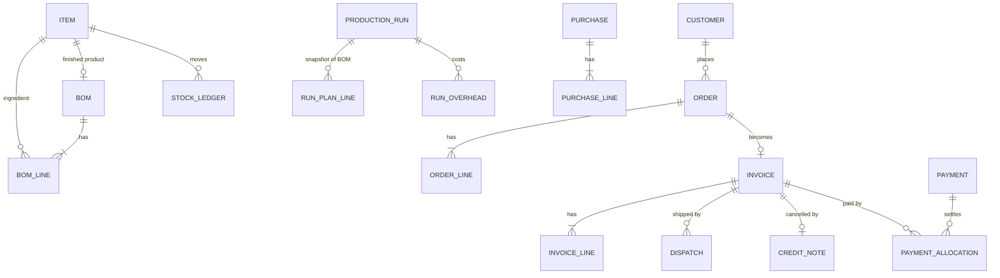

# Design note

## Data model (core)

`STOCK_LEDGER` rows point to their source via `(source_type, source_id)` = purchase | production_run | dispatch | credit_note | adjustment | opening | run_overhead.

## How stock is computed

Quantities are integers in base units (g, ml, pcs); `kg`, `l`, `carton` (= `packets_per_carton` packets, finished goods only) convert at the edge and fractions finer than the base unit are rejected. **There is no stored balance.** Balance = `SUM(qty_delta)` over the append-only ledger, per item (and per batch for finished goods). Every movement goes through `inventory.post()`, which refuses to go negative and values issues at the running weighted-average cost. Roll-forward report: opening + receipts − issues ± adjustments = closing, and `/inventory/reconcile` cross-checks ledger totals against production, dispatch documents.

Available-to-promise for finished goods = on hand − (undispatched invoice quantity + approved-not-invoiced orders). This is what the approval screen shows and why order B sees a 32-packet shortage.

## BOM consumption and variance

BOM = packets per batch + base-unit quantity per batch for each raw/packaging item. Creating a run snapshots planned quantities (BOM × batches, so later BOM edits don't rewrite history; `bom_version` is kept). Issues, packaging used and wastage are ledger rows tagged with the run. Variance per line = (actual − planned)/planned in basis points, flagged when |variance| > tolerance (default 3.00%, a setting); yield compares good packets with expected. Items issued but not in the BOM are flagged as unplanned.

## Costing and valuation

Method: **moving weighted-average cost** (justified in README). Run cost = value of issued + wasted materials/packaging + run overheads; cost per packet = run cost ÷ good packets (rejected packets and damaged pouches are absorbed by good ones). Monthly pool overhead is allocated to the month's runs by good-packet share. Margin = selling price − cost per packet.

## Money & tax

Integer paise throughout. GST per line: intra-state CGST = SGST = round-half-up(taxable × rate/2), inter-state IGST = round-half-up(taxable × rate). Invoice total rounded to rupee with explicit round-off. Numbering `INV/2026-27/0001` from a row-locked per-FY series; credit notes `CN/…` the same way. Posted invoices are never edited or deleted — cancellation creates a credit note, returns dispatched lots to stock at their original value, and is audit-logged.

## Audit

`audit_log` (append-only) records user, time, action, entity, before/after JSON for order edits/approvals, invoices, dispatch, runs, overheads, purchases, payments, adjustments, master changes, user changes and login failures.
